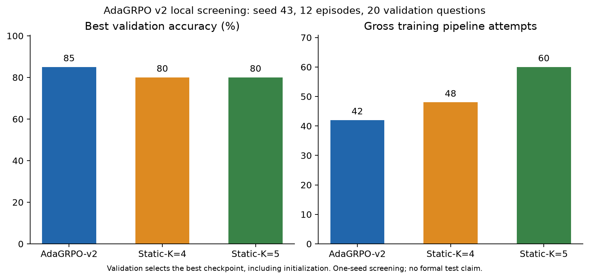

# AdaGRPO v2 implementation and controlled local study

Implemented on `amanur` under D032 in [DECISIONS.md](DECISIONS.md). [Self-contained notebook](../AdaGRPO_GSM8K_v2.ipynb). V1 results are historical context, not matched v2 controls.

## Implementation

Preserves Figure-2 sum loss, numeric exact rewards, LR 1e-5, GPT-2 first-token grammar/signature collisions, all-candidate replay and finite equal-reward Adam steps. Two correct probes stop at two; failed/cancelled groups stop at four; useful groups may refine to six using saved gross budget. Outcome-dependent stopping changes the estimator; the K-minus-one expectation identity does not imply Adam equivalence.

Candidate streams isolate episode/candidate sampling; validation streams are per question. Policy/data/runtime/sampling identities bind validation progress; completed journal outcomes survive interruption before progress publication. Changed identities archive/reject reuse. Training candidates are not cached.

A persisted two-hour ledger covers smoke and all three seed-43 twelve-episode arms with new twenty-question validation, shared fifty-question training pool/schedule, checkpoints at 0/12 and budgets 48/48/60. One GPU policy is resident; Llama3.2:3b remains CPU-offloaded. Formal five-arm work is opt-in and blocked unless the local gate passes. No official test split is loaded locally.

## Verification and results

- Unchanged v1 regression: 93/93 checks passed (`adagrpo_v2_legacy_regression.json`).
- V2 regression: 163/163 checks passed, including 93 retained/adapted checks and 70 additions (`adagrpo_v2_self_checks.json`). Categorical calculations are synthetic fixtures, not performance results.
- Structural preservation confirms identical reward, loss, replay, update, initialization and action-scoring functions (`adagrpo_v2_method_preservation.json`).
- The frozen validation set has twenty questions with zero overlap against seventy recorded historical training/validation membership IDs. Training retains the exact fifty-question development pool.
- Live smoke passed: six gross training attempts, four evaluation attempts, two optimizer steps, and zero repeated evaluations after deliberate checkpoint reload. Both training groups had zero current gradient, so this is engineering evidence only.
- The matched seed-43 study has ended. Its status and screening decision are reported below; partial work is never treated as success.

The persistent ledger is `results/adagrpo_v2/local_suite.json`. It records all stages and the screening verdict. Final structured evidence is written to `docs/audit_artifacts/adagrpo_v2_local_study.json`. No final-test or cloud execution is authorized automatically.

## Watching and recovery

The live Codex PTY logs to `results/adagrpo_v2/training_terminal.log`. If terminal attachment is queued, run `Get-Content .\results\adagrpo_v2\training_terminal.log -Tail 30 -Wait` in Codex's integrated terminal. No external monitor is created. Closing a log viewer does not stop the worker.

Use `run_improvement_suite(resume=True)` for the same ledger only. The original absolute deadline and frozen code digest remain enforced. Copy complete run folders, including Git-ignored .pt checkpoints, to preserve resumability.

## Final local study outcome

Suite status: **completed**, 78.81 minutes from persisted start to completed comparison. Original deadline retained. Engineering checks: 163; completed-run artifact audits: 4 passed. All 183 historical files retain their original SHA-256. No official final tests or cloud training were run.

- smoke / adaptive: 2/2 episodes, completed, 6 gross training attempts, 4 gross evaluation attempts; best validation 1.0 at episode 0; actual K [2, 4].
- screen / static_k5: 12/12 episodes, completed, 60 gross training attempts, 40 gross evaluation attempts; best validation 0.8 at episode 0; actual K [5, 5, 5, 5, 5, 5, 5, 5, 5, 5, 5, 5].
- screen / adaptive: 12/12 episodes, completed, 42 gross training attempts, 40 gross evaluation attempts; best validation 0.85 at episode 12; actual K [4, 4, 4, 2, 2, 6, 2, 2, 2, 2, 6, 6].
- screen / static_k4: 12/12 episodes, completed, 48 gross training attempts, 40 gross evaluation attempts; best validation 0.8 at episode 0; actual K [4, 4, 4, 4, 4, 4, 4, 4, 4, 4, 4, 4].

Screening verdict: **promising, requires formal confirmation**.

- compute: True.
- accuracy: True.
- improves_initial: True.
- beats_static4: True.
- finite_updates: True.
- nonzero_gradient: True.
- varied_k: True.

This is one seed and twenty fresh validation questions. It does not demonstrate the two-point formal noninferiority target. No controller retuning was performed.

Evidence: [suite ledger](../results/adagrpo_v2/local_suite.json), [artifact audits](audit_artifacts/adagrpo_v2_artifact_audits.json), [preservation](audit_artifacts/adagrpo_v2_preservation.json), [engineering checks](audit_artifacts/adagrpo_v2_self_checks.json), [fresh kernel](audit_artifacts/adagrpo_v2_clean_kernel.json).

For cloud preparation, copy the successful local ledger AND its frozen membership folder into the same project layout; these are prerequisites, not authorization to launch. The five-arm formal estimate is 34,935 clean executions.

Matched-record verification: all three arms had identical episode-0 validation trajectories and rewards; the adaptive/static4 training prefix matched exactly for three episodes before allocation diverged. See [matching checks](audit_artifacts/adagrpo_v2_matching_checks.json). Final episode-12 validation was adaptive 0.85, static4 0.75, static5 0.75; the reported best static score 0.80 comes from initialization, as required by earliest-tie validation selection.

The result passes the prespecified local gate, but the accuracy gain over selected static checkpoints is one validation question. It is not a statistical demonstration of the full research target. The frozen controller and formal workflow are prepared; no cloud experiment was launched.
