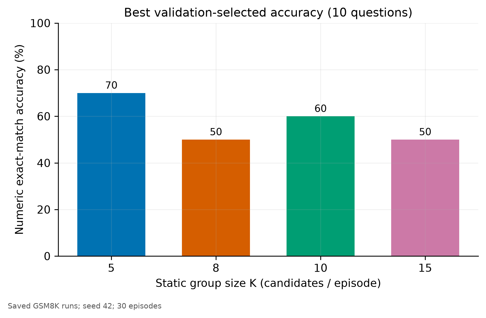
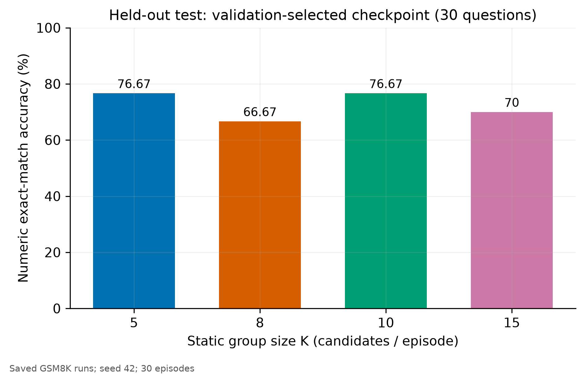
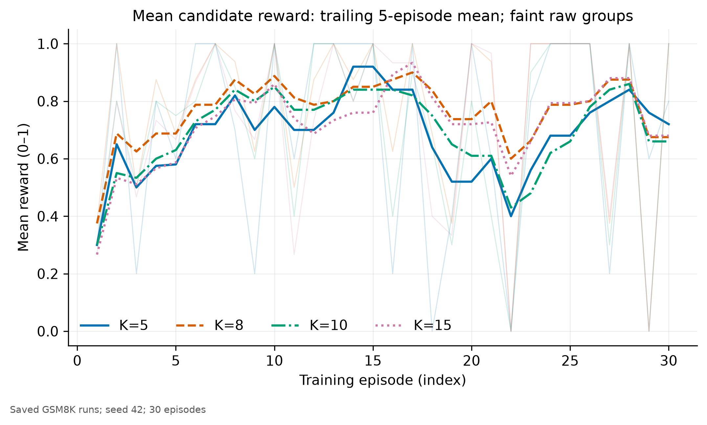
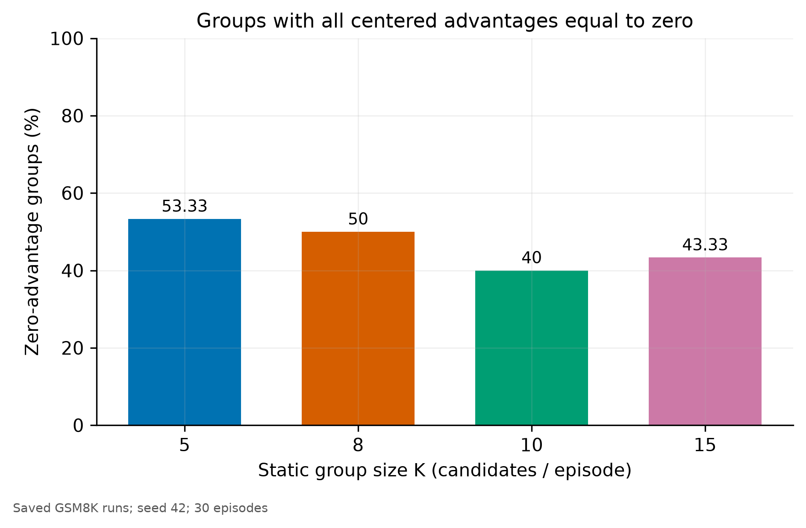
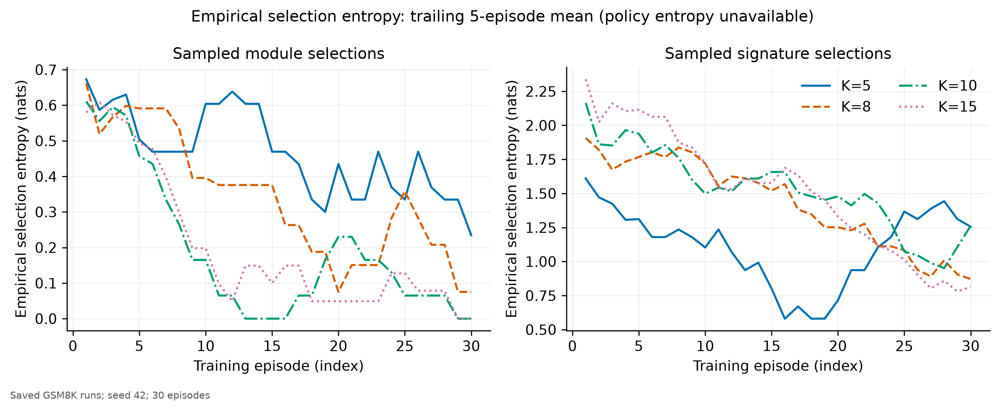
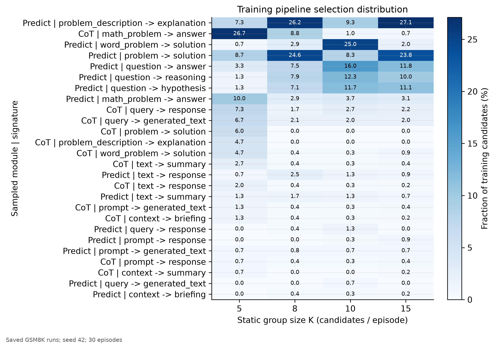
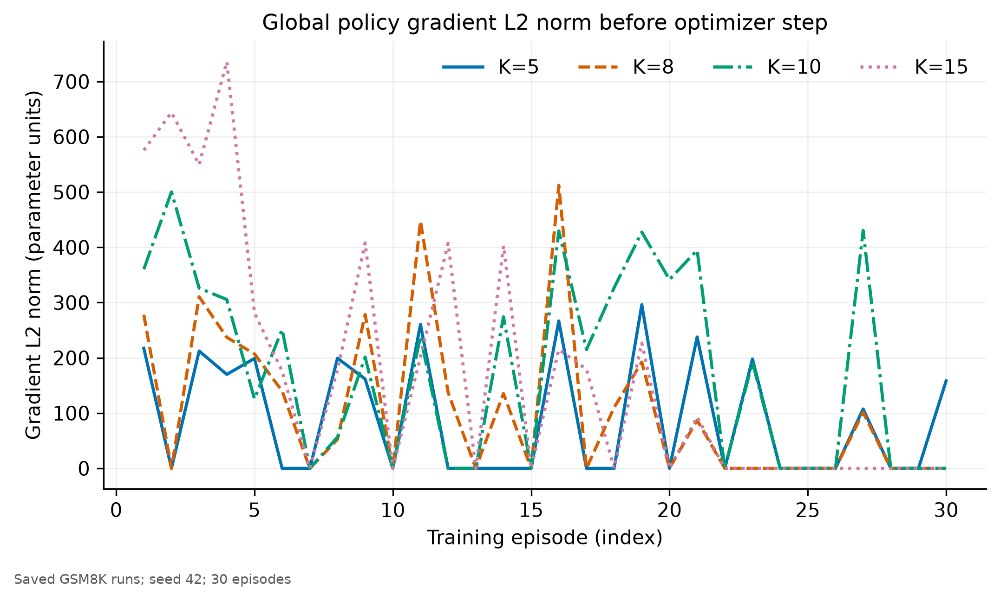
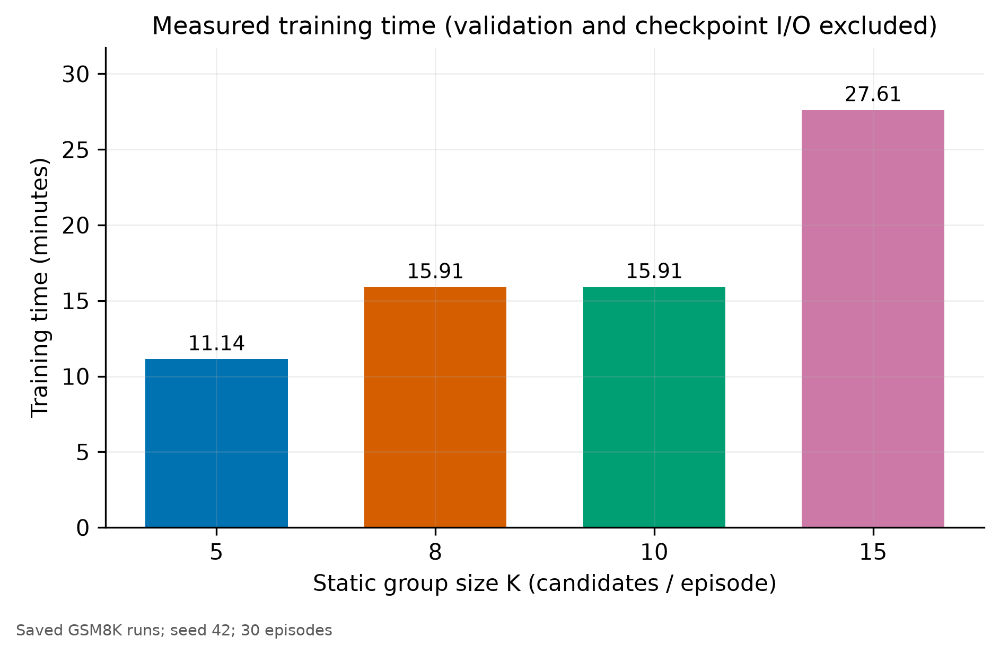
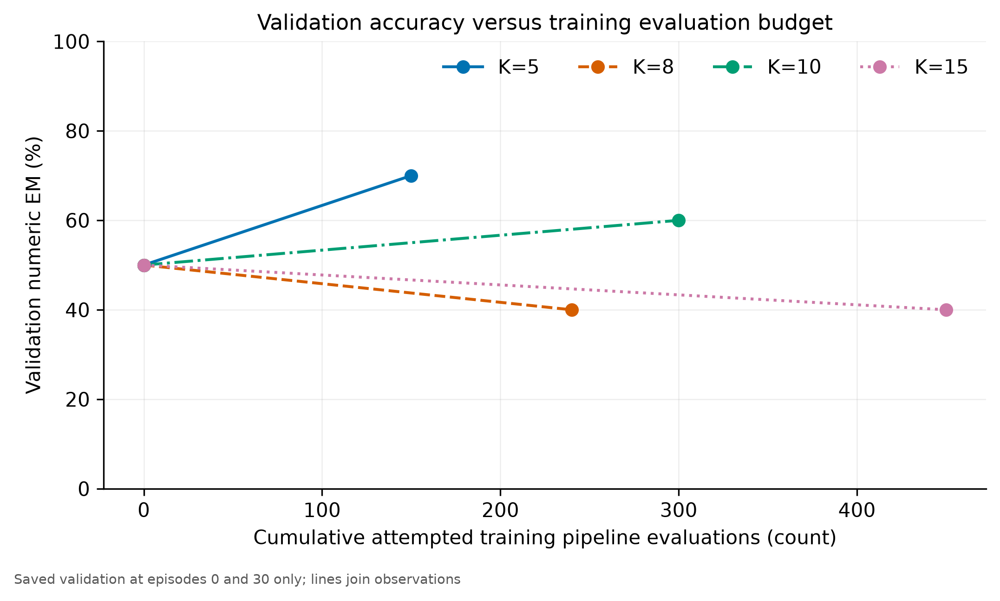
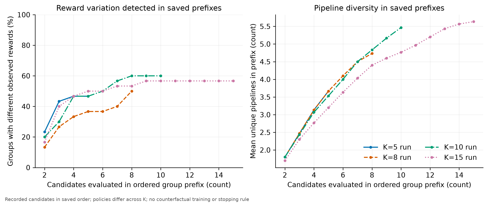

# Static-K GRPO on GSM8K: saved experimental results

Analysis date: 14 October 2026 (Asia/Dhaka). All results below come from saved artifacts. No training, checkpoint evaluation, or new LLM inference was performed. The original Figure 2 loss and all existing experiment artifacts were preserved.

**Principal finding:** K=5 has the highest validation-selected accuracy (7/10), the lowest measured training time (668.57 seconds), and the fewest training candidate evaluations (150). K=10 matches its held-out score (23/30) but uses twice the training evaluations. Increasing K does not produce a monotonic accuracy improvement or eliminate groups without a reward contrast. This is descriptive evidence from one seed and very small evaluation sets; it does not establish an optimal K or a statistically significant advantage.

## 1. Experimental configuration and comparability audit

The four completed runs found on disk are:

| K | Run under `results/gsm8k/` | Selected checkpoint |
| --- | --- | --- |
| 5 | `k5/seed42/baseline/20261013T174921-b1ad8988` | `episode_0030_689ac93f.pt` |
| 8 | `k8/seed42/baseline/20261013T181104-322720b3` | `episode_0000_694f9169.pt` |
| 10 | `k10/seed42/baseline/20261013T183759-77b8ce57` | `episode_0030_ebdecd4f.pt` |
| 15 | `k15/seed42/baseline/20261013T190031-8d8e40ec` | `episode_0000_29cb2d83.pt` |

All four runs have identical recorded non-K configurations, hardware/package snapshots, initial policy digests, execution-model metadata, and selection manifests. Their shared controls are:

| Control | Saved value |
| --- | --- |
| Dataset | `openai/gsm8k`, `main` |
| Dataset revision | `740312add88f781978c0658806c59bc2815b9866` |
| Policy | `gpt2`, revision `607a30d783dfa663caf39e06633721c8d4cfcd7e` |
| Initial policy digest | `e563ffe10e2eefeaf9d9a869d4cb43369cdddbe6875789caec4e1abd7c6adfd9` |
| Execution and semantic judge | `llama3.2:3b`, Q4_K_M, Ollama 0.33.2 |
| Execution-model digest | `a80c4f17acd55265feec403c7aef86be0c25983ab279d83f3bcd3abbcb5b8b72` |
| Optimizer / learning rate | Fresh Adam / `1e-5` |
| Seed | 42 in all runs |
| Recorded preset / actual episodes | `baseline` / **30** |
| Training pool / encountered questions | **50** / **22 unique questions in 30 draws** |
| Validation / held-out subset | **10** official training-split questions / **30** official test-split questions |
| Schedule | Same persisted 200-episode schedule; identical first 30 draws, with replacement |
| Selection digest | `fa3636bdff13ceb22c646ba250bd49ac056b8918d4921884b5e454e9fe8a643a` |
| Validation cadence | Configured interval 50; actual validation at episodes **0 and 30** |
| Checkpoints | Episodes 0, 25, 30 for every K |
| Execution settings | Temperature 0; 512 output-token limit; context 4096; seed 42; cache disabled; no explicit `num_gpu` |
| Policy settings | CUDA; dropout disabled; restricted first-token multinomial; maximum policy input 1024 tokens |
| Pipeline grammar | One module, one signature, deterministic stop; 2 modules × 15 signatures |
| Reward | Numeric exact match gives 1; mismatches receive the same Llama semantic fallback score in [0,1] |
| Evaluation | One sampled pipeline per question, fixed split-specific policy RNG seed; strict numeric EM |
| Hardware | RTX 3060 Laptop GPU, recorded 6,441,926,656-byte capacity |
| Runtime | Python 3.13.7; Torch 2.6.0+cu124; CUDA 12.4; Transformers 5.14.1; DSPy 3.3.0; Datasets 5.0.1; NumPy 2.4.4; Matplotlib 3.11.1 |

**Differences from documented defaults:** the guide describes 200 episodes and a 200-question pool, while these saved `baseline` runs explicitly override them to 30 and 50. Validation/test subsets are also reduced. The notebook overview/defaults refer to Llama 3.1 8B; these runs explicitly use Llama 3.2 3B, consistent with the requested analysis. These are shared protocol deviations, not differences between the four runs. This analysis changes none of them.

The audit checks complete episode histories, exactly K candidates per episode, schedule/manifest checksums, split disjointness, candidate/detail alignment, group-centered advantages, recomputed summed Figure 2 losses, finite recorded gradients, validation counts and numeric EM, summary/journal resource totals, checkpoint pointers, and held-out checkpoint/question provenance. Metadata from **all 12 checkpoint files** was read on CPU using fake tensors, without materializing model weights. Embedded histories match the logs; episode-0 Adam states are empty and later states contain the recorded updates. Recorded initialization identity is compatible; an independent bytewise comparison of initial tensor values was not performed.

The current notebook contains policy diagnostics absent from these saved logs. A training-source commit/hash was not saved for each run, so matching configuration snapshots cannot independently establish identical source code throughout execution. The audit therefore establishes compatibility of the **recorded protocol**, with that provenance limitation.

Sources: [configuration audit](../results/gsm8k/static_k_analysis/configuration_audit.csv), [checkpoint metadata](../results/gsm8k/static_k_analysis/checkpoint_metadata.csv), [run inventory](../results/gsm8k/static_k_analysis/run_inventory.csv), [guide](../STATIC_K_EXPERIMENT_GUIDE.md), and notebook sections 9, 12–19, 24.

## 2. Summary comparing all four K values

Accuracy is strict numeric exact match. The primary procedure chooses the largest **validation** accuracy and the earliest episode on ties; held-out scores never participate in selection. A negative validation-minus-test difference means the selected checkpoint scored higher on the test subset.

| Metric | K=5 | K=8 | K=10 | K=15 |
| --- | ---: | ---: | ---: | ---: |
| Initial validation accuracy | 50% | 50% | 50% | 50% |
| **Best validation accuracy** | **70% (7/10)** | 50% (5/10) | 60% (6/10) | 50% (5/10) |
| Episode of selected checkpoint | 30 | **0** | 30 | **0** |
| Final checkpoint validation accuracy | 70% | 40% | 60% | 40% |
| Held-out test accuracy of selected checkpoint | 76.67% (23/30) | 66.67% (20/30) | 76.67% (23/30) | 70% (21/30) |
| Selected validation minus test (percentage points) | −6.67 | −16.67 | −16.67 | −20.00 |
| Mean training reward | 0.7000 | 0.7708 | 0.7083 | 0.7333 |
| Mean within-group reward variance | 0.0880 | 0.0823 | 0.1063 | 0.0961 |
| Pooled candidate reward variance | 0.2067 | 0.1704 | 0.2008 | 0.1933 |
| Mean absolute policy loss | 0.5082 | 0.4304 | 0.8702 | 0.8298 |
| Mean / maximum gradient L2 norm | 89.50 / 296.19 | 107.56 / 512.09 | 179.95 / 500.40 | 175.79 / 735.82 |
| Episodes with gradient norm > 1e-8 | 14/30 (46.67%) | 15/30 (50%) | 18/30 (60%) | 17/30 (56.67%) |
| Zero-advantage groups | 16/30 (53.33%) | 15/30 (50%) | 12/30 (40%) | 13/30 (43.33%) |
| Groups containing different rewards | 14 (46.67%) | 15 (50%) | 18 (60%) | 17 (56.67%) |
| Groups mixing strict correct/incorrect answers | 15 (50%) | 15 (50%) | 16 (53.33%) | 17 (56.67%) |
| Groups mixing positive/zero reward | 14 (46.67%) | 13 (43.33%) | 17 (56.67%) | 16 (53.33%) |
| Mean unique pipelines per group | 3.67 | 4.73 | 5.47 | 5.63 |
| Mean unique pipelines / K | 73.33% | 59.17% | 54.67% | 37.56% |
| Training attempted / successful pipeline evaluations | 150 / 150 | 240 / 240 | 300 / 300 | 450 / 450 |
| Total measured LM calls, including evaluation | 268 | 382 | 476 | 669 |
| Measured training time (minutes) | **11.14** | 15.91 | 15.91 | 27.61 |
| Average episode time (seconds) | 22.29 | 31.81 | 31.82 | 55.21 |
| Mean pipeline execution latency (seconds) | 2.81 | 2.90 | 2.19 | 2.67 |
| Peak PyTorch allocated / reserved memory (GiB) | 2.869 / 3.566 | 2.868 / 3.566 | 2.867 / 3.566 | 2.864 / 3.566 |

The mean within-group variance measures useful reward contrast for centering. The existing `summary.json` reward variance is the pooled variance across candidates, including variation between questions. These answer different questions and are reported separately. Full precision and further fields are in [summary.csv](../results/gsm8k/static_k_analysis/summary.csv); missing metrics are explicitly listed in [missing_metrics.csv](../results/gsm8k/static_k_analysis/missing_metrics.csv).

## 3. Model performance analysis

Increasing K does **not** monotonically improve validation accuracy: selected scores are 70%, 50%, 60%, and 50%. Relative to their common 50% initial validation accuracy, the final checkpoints change by +20, −10, +10, and −10 percentage points. K=5's lead over K=10 is only **one validation question**. Validation was measured at only two points, so the analysis cannot identify the best intermediate episode or establish a smooth learning curve.

K=8 and K=15 select the untrained episode-0 checkpoint. Their test results therefore describe the validation-selected starting policy, rather than gains from their 30 training updates. Their final checkpoint test accuracies are **unavailable**. K=5 and K=10 select trained episode-30 checkpoints and both score 23/30; their correct-answer sets differ, with three questions correct only for K=5 and three only for K=10. Equal accuracy does not imply identical behavior.

There is a direct repeatability warning: the K=8 and K=15 episode-0 tests sample the same pipeline on **all 30 questions**, yet five output strings differ and one strict correctness outcome changes, producing 20/30 versus 21/30. Both have the same recorded starting-policy and execution-model identities. This is observed execution variability; its cause cannot be identified from the saved metadata. It prevents interpreting that one-question difference as a training effect of K.

All selected test accuracies exceed selected validation accuracy. With 10 and 30 different questions, this does not establish superior generalization or the absence of overfitting: subset difficulty, pipeline draws, and execution variability can explain the difference. The dataset IDs are disjoint, and test scores were not used for checkpoint selection. No formal significance claim or across-seed confidence interval is justified.





Sources: [evaluation metrics](../results/gsm8k/static_k_analysis/evaluation_metrics.csv), [held-out records](../results/gsm8k/static_k_analysis/held_out_records.csv), [paired test outcomes](../results/gsm8k/static_k_analysis/paired_test_comparison.csv).

## 4. GRPO learning behavior and group effectiveness

The saved objective is unchanged:

\[
\bar r=\frac1K\sum_{i=1}^{K}r_i,\qquad A_i=r_i-\bar r,\qquad
\mathcal L=-\sum_{i=1}^{K}\sum_t\log\pi_\theta(a_{i,t}\mid s_{i,t})A_i.
\]

There is no division of the loss by K, PPO clipping, entropy regularization, GAE, KL penalty, or reward normalization. The analysis recomputed every logged loss from saved action log probabilities and centered rewards within numerical tolerance; it did not change or rerun updates.

K=10 has the largest fraction of reward-varying groups (60%) and nonzero-gradient episodes (60%). K=15 falls to 56.67% despite an additional 150 training candidate evaluations. Compared with K=5, K=15 has only three more nonzero-gradient episodes while evaluating 300 more candidates. Larger K sometimes finds a reward contrast, but these runs do not support a monotonic improvement.

“Nonzero gradient” here means a recorded global L2 norm above **1e-8 before Adam**. Counts are identical at thresholds 0, 1e-12, 1e-8, and 1e-6. This is an operational signal, not proof that an update improves accuracy. In this dataset it coincides with reward-varying group counts. Equal rewards make all current advantages and gradients zero, but the recorded optimizer still takes a step; existing Adam momentum can move parameters even without a current gradient. Zero-advantage episodes cannot be equated to unchanged weights.

Strict-answer mixtures, reward mixtures, and execution mixtures are distinct. At K=5 episode 20, a group contains strict correct and incorrect answers but all candidates receive reward 1, so its advantages are zero. At K=10, two reward-varying groups have no mixture of strict correct/incorrect outcomes; their variation comes from semantic reward differences among strict mismatches. All pipeline executions succeed, so the number of groups mixing execution success/failure is zero. Groups mixing full reward 1 and sub-full reward number 14, 15, 18, and 17.

Training reward is not consistently increasing. Means in episodes 1–10, 11–20, and 21–30 are:

| K | First third | Middle third | Last third |
| --- | ---: | ---: | ---: |
| 5 | 0.6800 | 0.7200 | 0.7000 |
| 8 | 0.7875 | 0.7938 | 0.7313 |
| 10 | 0.7400 | 0.7250 | 0.6600 |
| 15 | 0.7233 | 0.7400 | 0.7367 |

Different questions occur across episodes; repeated-question schedules are shared across K but do not make an individual temporal reward trend a causal learning estimate. K=8's highest average reward alongside declining final validation illustrates the mismatch between a training reward and the primary accuracy metric.





Source: [episode metrics](../results/gsm8k/static_k_analysis/episode_metrics.csv) and [phase summaries](../results/gsm8k/static_k_analysis/phase_summary.csv).

## 5. Pipeline diversity analysis

Mean absolute diversity rises with K, but much less quickly than candidate count. K=10 to K=15 increases average unique pipelines from 5.47 to 5.63—approximately **0.17 additional pipelines per group for five additional candidates**. Normalized diversity declines from 73.33% at K=5 to 37.56% at K=15. Duplicate samples can still refine empirical reward frequencies; low unique/K is not by itself proof that every duplicate evaluation is useless.

Even at a fixed categorical policy, expected occupancy is `sum_j [1 - (1-p_j)^K]`, which has diminishing increments as K grows. Consequently, declining unique/K is partly an inherent sampling effect and cannot establish policy collapse. The within-K temporal concentration below provides more direct evidence of reduced sampled exploration.

The leading pipelines over the full histories are:

| K | Most frequent | Second | Third |
| --- | --- | --- | --- |
| 5 | CoT / `math_problem -> answer`: 40 (26.67%) | Predict / `math_problem -> answer`: 15 (10%) | Predict / `problem -> solution`: 13 (8.67%) |
| 8 | Predict / `problem_description -> explanation`: 63 (26.25%) | Predict / `problem -> solution`: 59 (24.58%) | CoT / `math_problem -> answer`: 21 (8.75%) |
| 10 | Predict / `word_problem -> solution`: 75 (25%) | Predict / `question -> answer`: 48 (16%) | Predict / `question -> reasoning`: 37 (12.33%) |
| 15 | Predict / `problem_description -> explanation`: 122 (27.11%) | Predict / `problem -> solution`: 107 (23.78%) | Predict / `question -> answer`: 53 (11.78%) |

There is strong **sampled module concentration**, particularly for larger K. Predict's share in the last ten episodes is 16% at K=5, 91.25% at K=8, 99% at K=10, and 98% at K=15. K=10's near-total Predict selection and K=15's decline in signatures are evidence of reduced observed exploration, not proof of irreversible full-policy collapse.

Mean unique pipelines per group in the first versus last ten episodes are 4.0→4.2, 6.3→3.2, 6.7→4.2, and 8.5→3.2. K=5 has a temporary middle-third contraction (2.8) and recovers. K=15 ends with about the same absolute diversity as K=8 while attempting almost twice as many candidates per episode. Its last-third normalized diversity is only 21.33%.

**Entropy integrity:** true module/signature policy entropy is **unavailable** because full conditional action probabilities were not logged. Selected-action log probabilities cannot reconstruct it. The exported substitute is empirical entropy of sampled selections, using natural logs, without pseudocounts. Mean per-group empirical module entropy is 0.4303, 0.3119, 0.1529, and 0.1612 nats; signature entropy is 1.0923, 1.3689, 1.4847, and 1.4286 nats. These are finite-sample plug-in estimates, influenced by K, conditioning question, and category occupancy. Cross-K comparisons must not treat them as unbiased policy entropy estimates. Aggregate and phase entropies are also exported; they have different scopes.

The restricted first-token action sampler shares token IDs among some signature entries. These action-space constraints are common to every run and can limit exploration independently of K.





Sources: [pipeline distribution](../results/gsm8k/static_k_analysis/pipeline_distribution.csv), [phase summaries](../results/gsm8k/static_k_analysis/phase_summary.csv), and notebook section 9.

## 6. Training stability and reward integrity

All recorded losses and gradient norms are finite. Recorded training/evaluation execution failures, failed LM calls, judge exceptions, and training out-of-memory events are zero for every K. These are actual recorded zeros, distinct from unavailable wall-clock/HTTP/entropy measurements. This supports operational stability of the completed histories, not reward correctness.

Because the Figure 2 objective **sums over K**, gradient scale is part of the treatment when K changes. For iid candidates conditional on a fixed question/policy, let `S_i` be the trajectory score gradient and treat rewards as fixed during differentiation. Since `E[S_i]=0`, centering with the same group's mean gives `E[gradient L] = -(K-1) E[r_i S_i]`. Thus the unnormalized expected gradient is size-dependent even under idealized sampling. Correlated execution/judging, changed reward distributions, and diverging policies prevent assuming this scaling law fits the observed norm trajectory. The measured means rise from 89.50 at K=5 to 179.95 at K=10 and 175.79 at K=15; the largest individual norm is 735.82 at K=15. The loss magnitude and gradient norm are therefore not directly normalized comparisons of learning quality. Adam's moment normalization also prevents translating a larger raw norm into a proportional parameter step. No loss rescaling or learning-rate adjustment was made.

Semantic fallback gives positive reward to strict numeric mismatches **5, 14, 18, and 20 times** in training, including full credit **3, 8, 11, and 16 times**. Such credit can be reasonable when extraction misses a correct answer, but cannot automatically be counted as correct numeric EM. In the K=8 test artifact, `gsm8k:test:136` has target 6, extracted prediction 3, output `{27 * 2 / 3}`, and judge reward 1. Its strict accuracy remains incorrect. This example shows why semantic reward and primary accuracy must remain separate.

There is also direct evidence of **inconsistent judge scores on byte-identical output text**:

| K | Question / pipeline | Saved episodes | Rewards for the same output |
| --- | --- | --- | --- |
| 8 | `gsm8k:train:4423`, Predict / `question -> reasoning` | 1, 18 | 0, 0.5 |
| 10 | `gsm8k:train:4423`, Predict / `question -> reasoning` | 1, 5, 18 | 0, 0.5, 0.5 |
| 15 | `gsm8k:train:2477`, Predict / `question -> hypothesis` | 8, candidates 2/10/14 | 0.5, 0, 0 |

The K=15 inconsistency occurs within a single group. Thus “different rewards” is not an unqualified signal of useful candidate-quality variation. These artifacts lack the newer raw judge request/response traces, so the underlying cause is unresolved. The analysis preserves saved rewards and does not relabel them or estimate what alternate reward training would have achieved.



Sources: [candidate metrics](../results/gsm8k/static_k_analysis/candidate_metrics.csv), [reward disagreements](../results/gsm8k/static_k_analysis/reward_disagreements.csv), [repeated pipeline/output rewards](../results/gsm8k/static_k_analysis/repeated_pipeline_rewards.csv).

## 7. Computational efficiency comparison

Training evaluations are exactly 30×K. Each run also has 20 validation evaluations and 30 held-out evaluations. Journal entries match these effective histories; **no extra completed rollback attempts are observed**. In-flight interrupted requests, if any, cannot be recovered from completed journal entries.

| Resource | K=5 | K=8 | K=10 | K=15 |
| --- | ---: | ---: | ---: | ---: |
| Training pipeline attempts | 150 | 240 | 300 | 450 |
| Training + validation + test attempts / successes | 200 / 200 | 290 / 290 | 350 / 350 | 500 / 500 |
| Training measured LM calls | 203 | 311 | 409 | 599 |
| Evaluation measured LM calls | 65 | 71 | 67 | 70 |
| Total measured LM calls | 268 | 382 | 476 | 669 |
| Training input / output tokens | 50,864 / 22,070 | 80,084 / 34,351 | 104,655 / 42,483 | 153,658 / 64,516 |
| Total input / output tokens, including evaluation | 67,615 / 30,354 | 98,455 / 41,986 | 121,090 / 49,278 | 171,855 / 72,296 |
| Measured training seconds | 668.57 | 954.30 | 954.70 | 1,656.42 |
| Measured evaluation seconds | 152.38 | 130.16 | 116.83 | 136.66 |
| Training seconds per attempted candidate | 4.46 | 3.98 | **3.18** | 3.68 |
| Training attempts per nonzero-gradient episode | **10.71** | 16.00 | 16.67 | 26.47 |
| Training seconds per nonzero-gradient episode | **47.76** | 63.62 | 53.04 | 97.44 |

Measured calls mean DSPy `LM.forward` attempts, including semantic judges and adapter retries; they are not physical HTTP-request counts. Training time sums saved episode durations and includes pipeline sampling/execution, judging, policy probes where present, replay, and updates; it excludes validation/checkpoint I/O. Full end-to-end wall time and physical HTTP counts are **unavailable**. PyTorch allocated/reserved peaks exclude Ollama residency and cannot be reported as total GPU usage. Ollama snapshots exist, but are not a continuous system-wide memory peak measurement.

K=15 uses 3× K=5's training pipeline budget and 2.48× its training time without a selected accuracy improvement. Time does not scale exactly with K: K=8 and K=10 both take approximately 954 seconds, while K=10's measured pipeline execution latency is lower. Pipeline type, response length, semantic-fallback workload, and runtime variation can affect time; the saved data do not isolate their individual contributions.

**Efficiency ranking depends on the endpoint.** K=5 has the strongest observed accuracy-versus-total-cost result and the lowest cost per nonzero-gradient episode. K=10 has the lowest seconds per attempted candidate, but lower selected validation accuracy than K=5 and greater total cost. Candidate throughput is therefore not equivalent to research efficiency. K=5 dominates the other three observed configurations on best validation accuracy and measured total training cost; its test score ties K=10. This ranking is confined to these runs.





## 8. Limitations and potential confounding factors

- **One seed per K:** no independent training replicates, across-seed uncertainty estimate, causal attribution, or supported statistical-significance claim.
- **Small evaluation sets:** one validation question changes accuracy by 10 percentage points; one test question changes it by 3.33 points. Validation-selected maxima also have selection bias.
- **Sparse validation and short training:** only episodes 0/30 were evaluated, only 22 training questions were encountered, and the runs are not the guide's 200-episode baseline.
- **Unequal budgets:** equal episode counts imply different candidate, token, call, and time budgets. The two validation observations cannot estimate matched-budget accuracy at intermediate points.
- **Coupled gradient scale:** changing K changes both candidate information and the unnormalized summed objective. Fixed learning rate does not isolate information benefit.
- **Diverging policies:** identical episode-question schedules and seeds do not provide identical policy trajectories, candidate draws, or execution outputs once K changes RNG consumption and updates. Within-group prefixes also cannot be compared as if they came from a common policy across K.
- **Reward/accuracy mismatch and execution variability:** semantic credit and inconsistent identical-output judgments can introduce noisy advantages. K=8/K=15 initial-policy tests directly demonstrate output variability despite fixed saved settings.
- **Missing measurements:** true policy entropy, full wall time, physical HTTP counts, continuous total GPU peak, final-checkpoint tests for K=8/K=15, and per-run training-source revision are unavailable. No missing measurement was imputed as zero.
- **Action-space limitations:** two modules, first-token signature collisions, and task-agnostic signatures constrain the policy. Concentration does not establish irreversible collapse or prove that larger K caused it.
- **Historical workspace state:** pre-existing deleted historical K=5 runs were not restored or analyzed, and pre-existing untracked work was preserved. Conclusions concern the four completed runs actually present on disk.

## 9. Insights relevant to Adaptive-K research

The evidence motivates adaptive allocation as a **hypothesis**, not a demonstrated improvement. Static K allocates a full group to every question even when rewards remain equal, repeats many pipelines in concentrated policies, and does not provide a monotonic accuracy return on its cost.

An analysis of saved candidates in their actual order makes the marginal issue more concrete:

| Saved run | Groups with reward variation after first 5 | After first 8 | After first 10 | After full group |
| --- | ---: | ---: | ---: | ---: |
| K=5 | 14/30 | unavailable | unavailable | 14/30 |
| K=8 | 11/30 | 15/30 | unavailable | 15/30 |
| K=10 | 14/30 | 18/30 | 18/30 | 18/30 |
| K=15 | 15/30 | 16/30 | 17/30 | 17/30 |

For the observed K=15 policies, candidates 11–15 cost **150 evaluations** and identify no additional reward-varying groups beyond the first ten. They raise mean unique pipelines from 4.77 to 5.63, an additional 0.87 per group. For K=10, candidates 9–10 similarly add no new reward-varying groups beyond the first eight. These are descriptive prefix statistics, not an Adaptive-K policy or a counterfactual accuracy estimate. Further samples still change sample proportions, the group mean, centered advantages, and the summed loss; stopping earlier would change subsequent policies. Zero variation in a short prefix also does not prove that more sampling will fail.

Candidate signals and when they become available:

| Signal | Before sampling | After partial candidate evaluations | After full group | Research use / caveat |
| --- | --- | --- | --- | --- |
| Policy module entropy and expected conditional signature entropy | Available from current policy logits; historically **not saved** | Can be combined with observed diversity | Same pre-update quantity | Low entropy predicts collisions, but simply increasing K cannot repair a concentrated action distribution |
| Prompt features and previous-group history | Available | History can inform allocation | Current group's final statistics become next-episode history | No access to the current held-out answer; sparse repeated prompts limit learning a reliable rule |
| Unique pipeline count / duplicate fraction | Unavailable before actions are sampled | Available immediately after action draws, before execution; updated with each candidate | Exact full-group occupancy | Cheap potential signal; a duplicate can still have variable output/reward |
| Reward range, variance, strict-answer mixture | Unavailable for a new prompt before execution | Observable over the evaluated prefix | Exact observed full-group values | Judge inconsistency can mimic useful variation; training gold is allowed, test gold must not guide inference allocation |
| Marginal new pipelines or new reward values per added candidate | Unavailable initially | Observable sequentially | Full observed marginal history | Stochastic; early plateaus can miss rare informative samples |
| Candidate latency and measured tokens/calls | Prior-run estimates only | Measured for completed candidates | Complete recorded group cost | Supports a budget-aware decision; model/response mix can change estimates |
| Exact final centered advantages, full-group loss and gradient norm | Unavailable | Prefix versions are provisional | Require final group rewards and policy replay | Cannot be treated as a free pre-sampling signal; replay/backward has cost |
| Validation/test accuracy | Previous validation only | No current-group accuracy signal | Only later scheduled evaluation | Select checkpoints with validation; never tune allocation using held-out test results |

A future strategy could begin with a small probe, expand when observed diversity suggests extra candidates may find an informative contrast, and stop when marginal information remains low under a predefined budget. However, stopping only when a reward contrast appears can bias the group distribution. Identical-reward prefixes may indicate easy questions, uniformly wrong pipelines, or insufficient sampling—these should not be conflated. Diversity preservation may require a separate action-space/policy remedy; K adaptation alone is not guaranteed to improve exploration.



Source: [ordered prefix diagnostics](../results/gsm8k/static_k_analysis/observed_candidate_prefixes.csv). No Adaptive-K implementation was added.

## 10. Recommended next research experiment

First run a **replicated Static-K study with improved measurement**, before attributing gains to Adaptive-K. Prespecify several independent seeds (at least 3, preferably 5), a larger disjoint validation set and held-out set, the planned episode budget, and more frequent validation. Within each seed keep the same training schedule, GPT-2 initialization, Llama model/digest, reward method, and decoding controls across K. Preserve the original summed Figure 2 objective and record its scale as a limitation.

Save the full pre-update module/signature probability distributions, raw semantic-judge request/response traces and returned inference settings, per-candidate costs, a source-code revision, and end-to-end phase timings. Establish a fixed initial-policy evaluation control and investigate the observed identical-output judge disagreements in a separately authorized diagnostic experiment. Reward-method changes, if pursued, should form a separate documented protocol rather than silently changing this comparison.

Evaluate both equal-episode results and prespecified equal-candidate-budget checkpoints. Use validation for selection, then test the frozen selected checkpoint once on the same held-out questions per protocol. Compare accuracy and resource use across seeds; use paired per-question outcomes for the same test subset and avoid treating episodes on repeated questions as independent training replicates.

After that baseline, preregister an Adaptive-K pilot bounded by the tested static sizes, compare it with the best Static-K comparator on a common evaluation budget, and measure zero-advantage rate, informative gradients, duplicate sampling, judge-noise sensitivity, accuracy, and time. The present results identify promising signals and wasted-information risk; they do not show that adaptive stopping maintains accuracy or reduces training time.

### Artifacts, reproduction, and verification

All analysis and plotting functions are in the appended **section 24** of [Static_K_GRPO_GSM8K.ipynb](../Static_K_GRPO_GSM8K.ipynb). Existing cells, outputs, training methodology, and the original `DSPy_GRPO.ipynb` are unchanged. Execute only the section-24 definition cell, then:

```python
STATIC_K_ANALYSIS = analyze_saved_static_k()
```

This reads saved files, verifies compatible histories/checkpoint metadata, and exports summaries and figures without models, datasets downloads, or LLM requests. If additional completed repeats are present later, explicitly pass `run_dirs=[...]` with one completed run per K; ambiguous discovery stops instead of silently choosing a run. The source manifest hashes small artifacts and guards checkpoint size/mtime before and after analysis. Checkpoint tensor values are not rehashed.

Verification passed for all four run histories, all 12 checkpoint metadata records, and 13 lightweight checks covering incompatible inputs and unavailable measurements. Notebook format validation passed; all 45 prior cells and their outputs match the original notebook, and the reference notebook's byte hash is unchanged. All exported PNGs were decoded and visually inspected, vector exports exist, and report links resolve. [analysis_checks.json](../results/gsm8k/static_k_analysis/analysis_checks.json) and [data_processing_checks.json](../results/gsm8k/static_k_analysis/data_processing_checks.json) retain the check outcomes. Optional checks can be rerun with `static_analysis_self_checks()`; mutated inputs used by those checks never enter experimental summaries.

The required `graphify update .` completed with AST-only processing and no LLM calls. This installed extractor skips notebooks and does not refresh document/paper semantics; it also reported unavailable PDF extraction because its environment lacks `pypdf`. These navigation limitations did not affect direct notebook/log analysis or plot generation.

The exports are:

- `results/gsm8k/static_k_analysis/`: summary, per-episode/candidate/evaluation data, pipeline distributions, phase and ordered-prefix diagnostics, paired test outcomes, reward disagreements, repeated-output reward checks, configuration/checkpoint/source audits, missing metrics, figure manifest, definitions, and verification results.
- `results/gsm8k/static_k_comparison/`: **15 available figures**, each in PNG (300 dpi), PDF, and SVG. Eleven of the twelve requested plots are available. Requested plot 10, true policy entropy, is explicitly unavailable; plot 10b shows labeled empirical selection entropy. Additional figures show temporal unique-pipeline counts, selection distributions, and observed prefix variation/diversity.

All four held-out tests already exist and use their validation-selected checkpoints and the same saved 30 questions. No new final testing is required for this report. If a future run lacks a test, leave it unavailable and explicitly invoke the following in the existing fully configured notebook kernel only after authorizing inference:

```python
# NOT executed for this analysis. Reads the chosen run's immutable configuration.
run_dir = Path("results/gsm8k/k5/seed42/baseline/20261013T174921-b1ad8988")
cfg = json.loads((run_dir / "config.json").read_text(encoding="utf-8"))["config"]
best = json.loads((run_dir / "best.json").read_text(encoding="utf-8"))
# Release any active session before loading another policy.
# release_experiment(SESSION)
TEST_RESULT = run_operation(cfg, "test", checkpoint=best["checkpoint"])
```

Use the corresponding run directories in section 1 for K=8,10,15; each configuration points to the same immutable held-out manifest. Repeated tests must all be retained and inspected, rather than selecting a favorable test score. The main conclusion remains the validation-selected comparison, with substantial replication and measurement limits.
